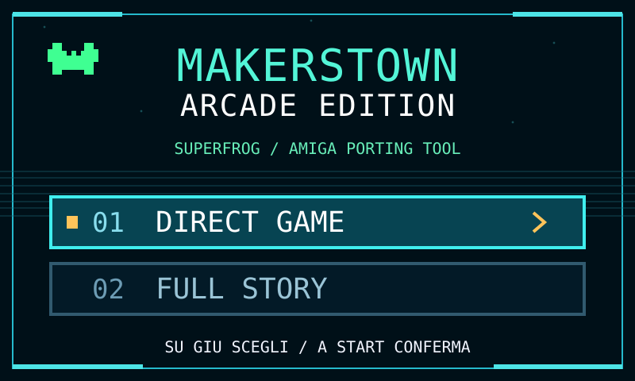

# Makerstown Superfrog Arcade Edition — ESP32-P4

**Version 1.0.0 · Hardware-validated · October 18, 2026**

An independent **Makerstown** project bringing the 1993 Amiga platform game *Superfrog* to an ESP32-P4 arcade setup through a specialized runtime. The project features a Makerstown graphical boot menu, menu music, and two independent entry points:

- **DIRECT GAME** — boots directly from game Disc 1 without processing the Story Disc first.
- **FULL STORY** — plays the complete intro Story Disc, then changes automatically to Disc 1.

Both modes were tested successfully on the ESP32-P4 arcade hardware. The direct-game startup is practical for arcade use.

## Hardware

The verified target is **ESP32-P4**, ST7701 MIPI display, ES8311 audio and a GPIO-connected arcade joystick. The engine uses a Motorola 68000 runtime, Amiga chipset emulation and Extended ADF media handling.

## Known issue

Some original PAL50 flashing sprite phases are not reproduced exactly by the optimized ~25 fps display presentation. **Frog blinking is a known issue in 1.0.0**, scheduled for future investigation without sacrificing gameplay fluidity.

## Roadmap

- Improve the PAL sprite blink presentation.
- Evaluate a **separate ESP32-S3 port**; the current P4 build has not been validated on S3.
- Investigate direct digital gameplay capture (USB/OBS) separately.

## Source and download policy

**This repository is a public project showcase, not a game distribution or an open-source release of the private Makerstown Amiga Porting Tool.** It does not include the private engine source, Amiga ROMs, commercial disk images, disk-derived loaders, or firmware that bundles third-party assets. The hardware-validated v1.0.0 build is documented here, but is **not downloadable from this public repository**.

## Makerstown and credits

- **Author:** Massimiliano Palombo — Makerstown
- **Makerstown HUB and project diary:** https://www.makerstown.cloud/hub/
- **GitHub:** https://github.com/Makerstown
- Original *Superfrog*: Team17 (1993). Independent, unofficial project; not affiliated with Team17.
- The private runtime uses the Musashi M68000 core (Karl Stenerud) and Espressif drivers, under their respective licenses.

See [v1.0.0 release notes](docs/RELEASE_NOTES_v1.0.0.md).

**Italiano:** [README.it.md](README.it.md).
